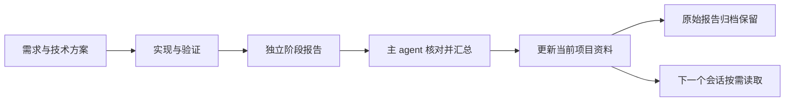

# Project Progress

**让下一个 agent 知道：项目为什么做、做到哪里、依据在哪、接下来做什么。**

使用 AI 开发一个持续推进的项目时，需求、方案和实现细节往往散落在很多轮对话里。换一个会话，或者让另一个 agent 接手，就需要重新解释背景；一些已经确认的规则、尚未完成的工作和没有验证的环节，也容易被遗漏。

Project Progress 是一个轻量的项目上下文维护 Skill。它让 agent 在开发过程中，把重要信息整理成持续维护的 Markdown 资料，供后续会话按需读取，也方便开发者回看项目过程。

**English:** A lightweight skill for durable project context and handoffs between coding-agent sessions. Keep requirements, designs, workspace details, implementation status, and verification evidence in Markdown. Workers submit separate reports; a coordinator consolidates three pending reports and archives the originals. Small, self-contained tasks do not need a project dossier.

[技能说明](skills/project-progress/SKILL.md) · [资料模板与接入片段](skills/project-progress/references/templates.md) · [完整演练](examples/README.md) · [MIT License](LICENSE)

## 它会帮你维护什么

- **项目背景与工作区**：项目目标、涉及的系统、代码位置、分支和 worktree。
- **需求**：已确认的业务规则、实施范围、验收条件和待确认问题。
- **技术方案**：实现方式、调用流程、修改范围，以及重要选择的原因。
- **推进状态**：已经实现什么、还缺什么、当前阻塞和下一步。
- **验证依据**：测试用例、实际执行结果和未验证事项，区分编译、Mock 与真实联调。
- **协作记录**：各 agent 的阶段成果，以及主 agent 整理后的有效结论。

资料默认存放在：

```text
~/Documents/progress/
└── 项目名称/
    ├── process.md       # 当前概况、进度和资料入口
    ├── requirements/    # 需求
    ├── designs/         # 技术方案
    ├── tests/           # 测试资料
    └── agent/           # 并行协作时的阶段报告
        └── archive/     # 已汇总的原始报告
```

目录按需建立。小需求可以直接完成，无需生成整套资料；同一项目的不同会话、仓库和 worktree 共用一个资料入口。可以指定其他可访问的资料位置。

背景和工作区先放主文件，较长内容再拆分。正式测试源码继续跟随业务仓库；这里链接其位置，并保留必要的用例、结果和样例。自己的真实项目记录与本仓库的技能和教学示例分别管理，无需提交到本仓库。

## 怎样开始使用

当前主要面向 Codex 的本地文件工作流。技能本体是 `skills/project-progress/` 下的三个文件，使用时不需要安装 Node.js、Python 或数据库。

从[仓库主页](https://github.com/iamy1m/project-progress)选择 **Code → Download ZIP**，解压后进入本仓库目录。也可以使用 Git：

```sh
git clone https://github.com/iamy1m/project-progress.git
cd project-progress
```

将 `skills/project-progress/` 文件夹复制到 Codex 的技能目录。macOS / Linux 用户可以在本仓库根目录执行：

```sh
(
  project_progress_target="$HOME/.agents/skills/project-progress"
  if [ -e "$project_progress_target" ] || [ -L "$project_progress_target" ]; then
    printf '目标已存在，请先比较现有安装：%s\n' "$project_progress_target"
    exit 1
  fi
  mkdir -p "$(dirname "$project_progress_target")"
  cp -R skills/project-progress "$project_progress_target"
)
```

该命令采用当前 [OpenAI Docs 的用户级技能目录约定](https://learn.chatgpt.com/docs/build-skills)，已有同名目录时会停止。如果宿主已从其他位置加载这个技能，请继续管理原副本，避免重复安装。需要仅对一个仓库启用时，也可以将技能目录放入该仓库的 `.agents/skills/`。

安装后检查 Codex 技能列表中是否出现 `project-progress`。若未出现，重新打开会话或按宿主说明刷新。文件复制成功与宿主实际发现技能是两项检查。

之后可以直接用自然语言表达需求。

### 建立记录

```text
使用 $project-progress，为当前项目建立和维护记录。
资料放在 ~/Documents/progress/我的项目/。

先核对已有需求、方案和相关工作区，只创建当前需要的资料。
未确认的方案保留为待确认，业务开发继续遵守当前任务的授权范围。
```

### 在新会话中接手

```text
使用 $project-progress，接手 ~/Documents/progress/我的项目/。

本轮先只读，通过 process.md 找到相关资料，
说明当前范围、实现情况、验证情况、阻塞和下一步。
```

### 同步本轮工作

```text
使用 $project-progress，在已授权范围内同步本轮重要变化。
更新相关需求、方案或测试资料，再同步项目总进度。
```

为了让后续会话找到资料，可以在项目 `AGENTS.md` 中接入[模板里的简短说明](skills/project-progress/references/templates.md#agentsmd-接入片段)。接入前填写项目的实际资料目录；安装或调用技能不会自动修改其他项目的 `AGENTS.md`。

## 多个 agent 一起工作时怎么办

先明确一个负责汇总的主 agent，以及其他 agent 各自的任务和报告文件范围。

协作 agent 将阶段成果写入独立报告。主 agent 在接手或阶段交付时检查，达到 **3 份已提交、尚未汇总的报告**便执行汇总；重要变化、阻塞和交接可以提前处理。归档、草稿和无关文件不计数。

汇总时先固定本次报告清单并核对依据，再更新正式资料。已经完整整合并核对的报告移入 `agent/archive/`，保留原文，方便追溯和复盘。新到或尚未处理的报告留待后续，同名归档不直接覆盖。



## 使用边界

它适合多阶段、跨会话、有重要规则或方案取舍的工作。普通问答、简单修改和没有形成结论的探索，无需逐轮记录。

它依靠 agent 遵守读写和协作约定，没有后台监听、自动唤醒或文件锁。记录用于帮助定位依据，接手时仍需核实相关代码和工作区；方案、用例预期也不能当作实际实现或测试通过。

记录维护遵守已授权的范围。只读接手时，达到汇总阈值也不会更新或归档。技能不能恢复从未保存的会话细节，也不因维护资料而扩大业务实施权限。

## 用一个虚构项目试一遍

[预约取消示例](examples/README.md)包含需求、方案、测试用例、3 份待汇总报告和 1 份历史归档，可以演练只读接手、三份报告汇总和原文归档。

示例没有真实业务代码或服务，方案建议、用例预期和真实执行结果明确区分。

## 验证范围与已知限制

这是 `v0.1.0` 初始试用版，核心指令与模板目前以中文维护，主要面向 Codex 的本地文件工作流。

发布包的检查范围包括：技能结构与 YAML、本地文档链接、安装命令的隔离复制与重复安装保护，以及人工按技能步骤进行的虚构资料汇总归档演练。

这些检查不代表宿主实际发现技能、独立 agent 行为或真实多会话并发已经验证。Windows、其他 agent 宿主以及后台自动化没有作为本版已验证能力发布。

如果它在项目里误触发、重复建档或造成结论冲突，可以通过 [Issues](https://github.com/iamy1m/project-progress/issues)提交场景、实际行为和预期行为。请使用虚构或脱敏材料。性能与效果数据将在有可复现测量后补充。

## 作者与许可

作者：[y1min (iamy1m)](https://github.com/iamy1m)。

本项目采用 [MIT License](LICENSE)。欢迎通过 Issues 或 Pull Request 提交改进建议、文档修正和使用案例，并说明实际验证范围。
